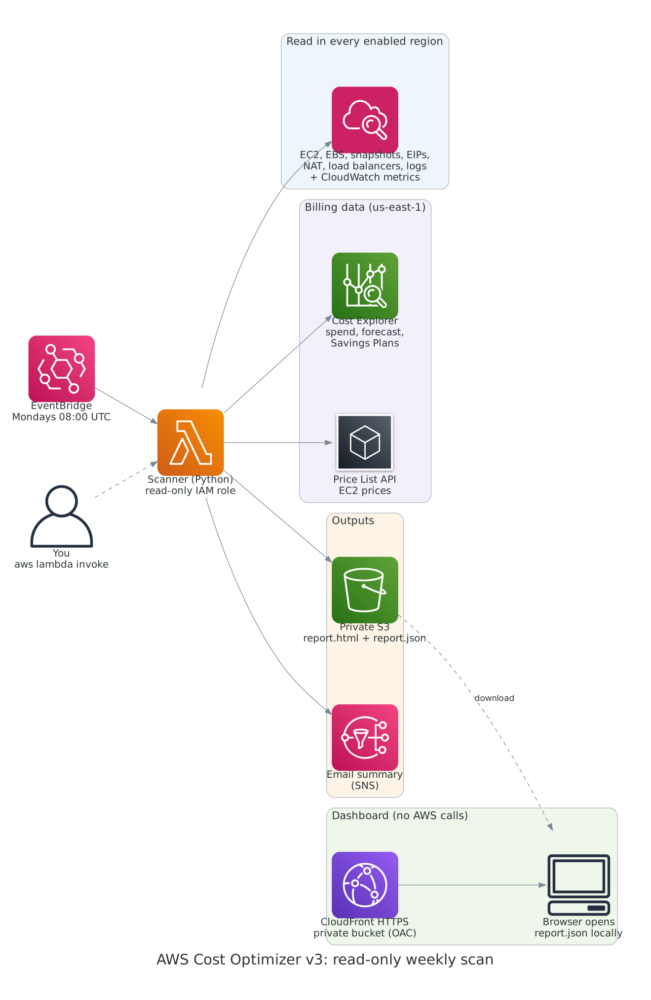

# CostPatrol: AWS cost optimization dashboard


**Live dashboard:** https://d3tzbznu0q3ftw.cloudfront.net (sample data; open a report file to see real results)

I built this because I kept seeing the same thing on AWS accounts: servers sitting idle, storage volumes nobody deleted, S3 buckets growing forever with no lifecycle rules. AWS doesn't tell you about any of it. It just bills you.

So I built a scanner that runs every Monday morning, checks every region in the account, reads the bill from Cost Explorer, and produces a report that ranks every saving by how much it is worth, how much work it is and how risky it is. The first time I ran it on my own account it found a t3.micro that had been running for a week at 0.56% CPU, doing nothing.

It is read-only. It never stops, deletes or changes anything.



## What it answers

**Why is the bill going up?** From Cost Explorer: last month's spend against the month before, the top 5 services, the services that rose the most, and AWS's own forecast for this month.

**Where is money being wasted?** These checks run in every enabled region:

| Check | What counts as waste | How the saving is priced |
|---|---|---|
| Idle EC2 instances | Average CPU under 5% for 7 days. Under 1%: stop it. Otherwise: one size down. | AWS Price List API, for that instance type and region |
| Unattached EBS volumes | Volumes not attached to anything | Published us-east-1 rate (estimate) |
| gp2 volumes | In-use gp2 volumes that can move to gp3 with no downtime | gp2 minus gp3 rate (estimate) |
| Old snapshots | Older than 90 days and not used by any AMI | Volume size, the most it can cost (estimate) |
| Elastic IPs | Not attached to anything | $0.005 per hour, what AWS charges per public IPv4 address |
| NAT gateways | Sent under 1 MB in 7 days | Hourly charge (estimate) |
| Load balancers | No healthy targets, or no traffic in 7 days | Hourly charge (estimate) |
| Log groups | No retention period, so logs are kept forever | Stored GB (estimate) |
| S3 buckets | No lifecycle rules | Shown for review; the saving depends on the data |

It also asks Cost Explorer for a Compute Savings Plan recommendation and shows it separately, because committing for a year is a business decision, not a clean-up.

**What should we do first?** Every finding gets a monthly saving, an effort (Low, Medium, High) and a risk (how likely the fix is to affect something still in use), then they are ranked, biggest saving first. See [`docs/sample-report.html`](docs/sample-report.html) for the format, with made-up data.

## How the report reaches you

- **Email:** a short summary through SNS: spend trend, total possible saving, and the top 5 items.
- **Private S3 bucket:** the full `report.html` (print it or save as PDF) and `report.json` for every week. Reports expire after 180 days.
- **Dashboard:** a static page on CloudFront over HTTPS. It shows labelled sample data, and you can open any `report.json` in it. The file is read in your browser and never uploaded. The page makes no calls to AWS.
- **Slack:** optional, the same summary as the email.

There is no public API. An earlier version exposed `POST /scan` with no login, which let anyone run a scan and read the results. Scans now run on the schedule or with `aws lambda invoke`, which needs your own IAM access.

## Using it for a one-off cost review

You do not have to deploy anything to review someone else's account. Ask them for a read-only role (the policy is the `aws_iam_role_policy` in `terraform/main.tf`, without the S3 PutObject and SNS statements), then:

```bash
pip install boto3
python scan.py --profile client-readonly
# writes reports/cost-report-<account>-<date>.html and .json
```

The `reports/` folder is git-ignored because it holds real account data.

## Deploy

You need the AWS CLI with credentials, and Terraform 1.5 or later. Cost Explorer must be enabled once in the Billing console (it can take up to 24 hours before data appears); until then the spend section is skipped and the rest of the report still works.

```bash
git clone https://github.com/cyberN3m3/AWS-Cost-Optimization-Dashboard.git
cd AWS-Cost-Optimization-Dashboard/terraform

cp terraform.tfvars.example terraform.tfvars   # set alert_email; git-ignored
terraform init
terraform plan
terraform apply
```

Then:

1. Click **Confirm subscription** in the email AWS sends, or the summaries will not arrive.
2. Run a scan now instead of waiting for Monday (the command is in the `run_scan_now` output):
   ```bash
   aws lambda invoke --function-name aws-cost-optimizer --cli-read-timeout 900 output.json && cat output.json
   ```
3. Download the report (`download_latest_report` output) and open it in the dashboard (`dashboard_url` output).

To remove everything: `terraform destroy`. The report and dashboard buckets are emptied and deleted with it.

## Cost

| Item | Cost |
|---|---|
| Lambda, EventBridge, SNS email, S3, CloudFront | Inside the free tier at one scan a week |
| Cost Explorer API | $0.01 per request; about 4 per scan, so about $0.16 a month |
| Price List API | Free |

## Security

The Lambda role can read inventory, metrics, billing and prices, write only to `reports/` in its own bucket, publish only to its own SNS topic, and write only to its own log group. Both buckets block all public access and refuse plain-HTTP requests. The dashboard bucket is readable only by its CloudFront distribution (Origin Access Control), and CloudFront adds HSTS and a strict Content Security Policy.

Checkov runs on every push. The checks it skips are listed next to each resource with the reason, for example no WAF on a static page with no API, and no customer-managed KMS key for a weekly report.

## Tests and CI

```bash
pip install -r requirements-dev.txt
python -m pytest -q
```

The tests use [moto](https://github.com/getmoto/moto) to fake AWS, so they create real-looking EC2 instances, volumes, snapshots, NAT gateways, load balancers and log groups without an AWS account. GitHub Actions runs the tests, `terraform fmt` and `validate`, and Checkov on every push and pull request.

## Project structure

```
lambda/
  lambda_function.py   # entry point: scan, build the report, save, notify
  checks.py            # one function per waste check
  spend.py             # Cost Explorer: spend, trend, forecast, Savings Plans
  pricing.py           # Price List API with a fallback table
  report.py            # ranking, HTML report, email summary
scan.py                # run the same scan from your laptop with any profile
terraform/
  main.tf              # scanner, schedule, IAM, private report bucket, SNS
  dashboard.tf         # private S3 + CloudFront (HTTPS) for the dashboard
frontend/index.html    # dashboard: sample data or a report file you open
tests/                 # pytest + moto
docs/                  # architecture diagram and a sample report
```

## What I'd add next

- **Multi-account:** assume a read-only role in each account of an AWS Organization and combine the findings.
- **RDS checks:** idle databases and old manual snapshots, which usually cost more than EC2.
- **Trend history:** compare each week's report with the last one to show whether waste is going down.

## License

MIT
